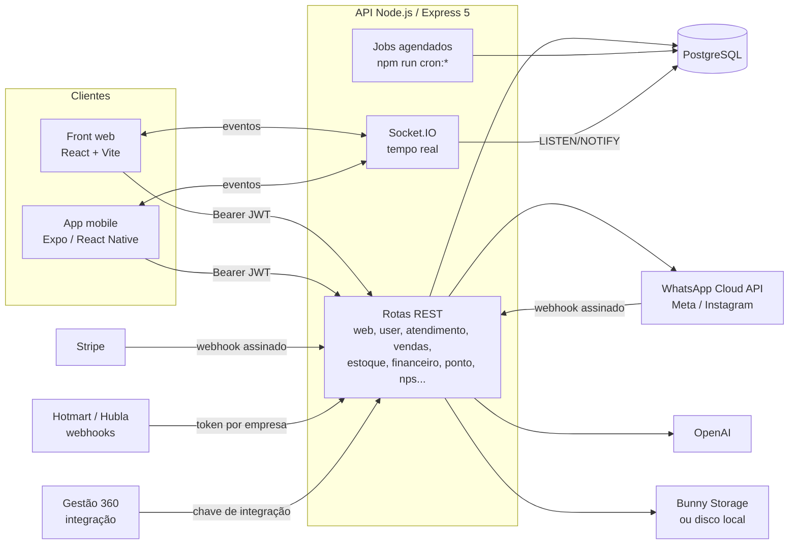

# Órbita CRM: CRM e gestão comercial multiempresa (web + app mobile)

Plataforma SaaS de CRM e gestão para pequenas e médias empresas. Junta num só lugar o **atendimento pelo WhatsApp** (WhatsApp Cloud API, com várias pessoas atendendo o mesmo número), o **funil comercial** com negócios, agendamentos e relatórios, **contatos**, **vendas/PDV**, **estoque**, **financeiro**, **NPS pós-atendimento**, **controle de ponto** e integrações de marketing (Meta Ads, Instagram, Google Ads). Cada empresa assina um plano, que define os módulos e os limites, e o usuário master define o que cada funcionário pode ver.

São três aplicações: a API (Node.js + PostgreSQL), o front web (React) e o app mobile (Expo / React Native) com os mesmos módulos.

> **Sobre esta versão.** Este é um projeto de equipe, construído para uma empresa e em produção, do qual participei. O desenvolvimento principal é de Marcelo (MarceloR23) e Andressa Karen (andressakaren), na equipe de tecnologia da empresa. Pelo histórico do git, minha parte foi a primeira versão do front web (estrutura inicial e primeiras telas) e, depois, contribuições nas telas de estoque e produtos (ofertas, categorias, código EAN), na tela de planos, no módulo comercial (pipeline, dashboard e relatórios), na tela de FAQ, em ajustes de tema e na integração com o Gestão 360 (back e front). Também preparei esta versão pública.
>
> Esta é uma versão anonimizada de um sistema real, desenvolvido para uma empresa: nomes, marca, domínios, conteúdo proprietário e dados foram substituídos por fictícios. Saíram também chaves, ids de integrações e scripts de servidor. Nesta cópia corrigi falhas de segurança encontradas numa revisão do código (veja [Segurança](#segurança)). A arquitetura, as regras de negócio e o restante do código são os do sistema real.

**English summary:** Team-built, multi-tenant CRM/ERP SaaS, a real system built for a company. The main developers were two teammates (Marcelo and Andressa Karen); I contributed the first version of the web front end and several later features, and prepared this anonymized public version. Stack: Node.js + Express 5 + PostgreSQL API, React 19 + TypeScript + Vite web app, Expo / React Native mobile app. It covers shared-inbox WhatsApp support (Cloud API, realtime with Socket.IO; integration updates fan out through PostgreSQL LISTEN/NOTIFY), a sales pipeline with dashboards and scheduled template campaigns, contacts, POS/sales, inventory, finance, NPS surveys, time tracking with geolocation, Meta/Instagram/Google Ads integrations, Hotmart/Hubla purchase webhooks, outgoing developer webhooks, an AI conversation analyst (OpenAI), Stripe subscriptions and plan-based permissions. In this public copy I also fixed security issues found in a review: unsalted MD5 passwords (now bcrypt with transparent migration), a global password-reset code, an unsigned non-expiring onboarding link, hard-coded credentials, cross-tenant IDOR and missing role checks. Runs locally with `docker compose up` or with Node + PostgreSQL, no external accounts needed.

---

## Sumário

- [O que a plataforma faz](#o-que-a-plataforma-faz)
- [Arquitetura](#arquitetura)
- [Stack](#stack)
- [Rodar localmente](#rodar-localmente)
- [Contas de demonstração](#contas-de-demonstração)
- [Roteiro para testar](#roteiro-para-testar)
- [Integrações](#integrações)
- [Segurança](#segurança)
- [Decisões técnicas](#decisões-técnicas)
- [Estrutura do repositório](#estrutura-do-repositório)
- [Variáveis de ambiente](#variáveis-de-ambiente)

---

## O que a plataforma faz

| Área | O que faz |
|---|---|
| **Atendimento (WhatsApp)** | Caixa de entrada compartilhada pela WhatsApp Cloud API: texto, áudio (gravação e conversão com ffmpeg), imagens, vídeos, documentos, figurinhas e localização. Fila de atendimento, transferência entre atendentes, cor por atendente, mensagens rápidas, janela de 24 h da Meta, bloqueio e denúncia de contatos, atualização em tempo real. |
| **IA no atendimento** | Análise da conversa com nota por etapa do funil, gargalos e próxima ação; sugestão de resposta com produtos do catálogo; correção do texto antes de enviar. Cada empresa pode gravar o próprio prompt. Usa a API da OpenAI. |
| **Comercial (CRM)** | Vários funis com etapas configuráveis (arrastar e soltar), negócios ligados a contatos e produtos, interações e agendamentos com calendário, negócios fechados, vendas consolidadas com importação por planilha, dashboard e relatórios. |
| **Disparos e automações** | Templates do WhatsApp (criação, envio em lote, histórico e custo estimado), disparos agendados, mensagens de aniversário, follow-up pós-venda e de clientes sem resposta, encerramento de atendimentos parados (jobs com `npm run cron:*`). |
| **Contatos** | Cadastro completo, tags, anotações, histórico, origem do lead (UTM e anúncio da Meta), importação e exportação em planilha. |
| **Vendas / PDV** | Venda direta, ligada ou não a um contato, com baixa de estoque. |
| **Estoque** | Produtos com código de barras, categorias e promoções; fornecedores; pedidos de compra e recebimento; estoque por filial. |
| **Financeiro** | Contas a pagar e a receber, parcelamento, contas financeiras, categorias, centros de custo, empresas do grupo, formas de pagamento com taxa, transferências e anexos. |
| **NPS** | Pesquisa enviada ao fim do atendimento por link assinado, perguntas configuráveis e relatório por período e filial. |
| **RH / Ponto** | Registro de ponto com geolocalização e raio por filial, horários de trabalho, justificativas com aprovação, férias, day off, feriados e banco de horas. |
| **Marketing** | Meta Ads (campanhas, leads e custo), Instagram (mensagens) e Google Ads (OAuth e relatórios). |
| **Conta e plano** | Planos Básico, Business e Enterprise com limites de usuários, filiais, funis e leads; adicionais; assinatura e portal de pagamento pela Stripe; histórico de pagamentos. |
| **Administração** | Usuários com permissões por módulo (limitadas pelo plano), filiais, cargos, configurações, manual/FAQ, novidades do produto, webhooks para desenvolvedores e página da API comercial. |
| **App mobile** | Os mesmos módulos em abas (chat, comercial, contatos, dashboard, estoque, financeiro, PDV, RH, Meta, Google Ads, usuários), push de novos atendimentos e configurações. |

---

## Arquitetura



**Fluxo principal de um atendimento**

1. A Meta envia a mensagem para `POST /meta/webhook`. A API confere a assinatura `X-Hub-Signature-256`, identifica a empresa pelo número e grava contato, conversa e mensagem.
2. A API emite o evento pelo Socket.IO só para a sala da empresa e da conversa, no web e no app. O app também recebe push.
3. O atendente responde pelo chat. Mídias vão para o armazenamento (Bunny ou disco local) e seguem pela Cloud API.
4. O contato entra no funil comercial. Negócios, interações e agendamentos alimentam o dashboard e os relatórios.
5. Ao encerrar, o cliente recebe o link assinado da pesquisa NPS.

---

## Stack

**Backend:** Node.js 20+, Express 5, PostgreSQL (`pg`, SQL escrito à mão em `models/`), Socket.IO, JSON Web Tokens, bcryptjs, Multer, Nodemailer, Axios, fluent-ffmpeg.

**Front web:** React 19, TypeScript, Vite 7, React Router 7, Recharts, TipTap (editor), @hello-pangea/dnd (funil), Leaflet (mapa do ponto), Socket.IO client, SheetJS (planilhas), DOMPurify.

**Mobile:** Expo SDK 54, React Native 0.81, Expo Router, expo-notifications, expo-location, expo-audio, expo-secure-store, react-native-gifted-charts, Jest + Testing Library.

**Infra:** Dockerfiles para API e front e um `docker-compose.yml` para o ambiente local. Em produção roda numa VPS com várias instâncias da API e cron do sistema; essa parte foi retirada deste repositório.

---

## Rodar localmente

### Opção 1: Docker (recomendado)

Pré-requisito: Docker Desktop.

```bash
git clone https://github.com/vitormouramaker/crm-erp-saas-platform.git
cd crm-erp-saas-platform
docker compose up --build
```

- Front: http://localhost:5173
- API: http://localhost:4444/health

Na subida, o compose cria o banco, aplica o schema e as migrações e cria as [contas de demonstração](#contas-de-demonstração).

### Opção 2: Sem Docker

Pré-requisitos: Node.js 20.19+ e PostgreSQL 14+ rodando localmente.

```bash
# 1. API
cd backend
cp .env.example .env          # ajuste DB_USER / DB_PASSWORD / DB_PORT se precisar
npm install
npm run db:init               # cria o banco orbita_crm, o schema e as migrações
npm run seed:demo             # contas de demonstração (senha Demo@123)
npm run dev                   # http://localhost:4444

# 2. Front web (outro terminal)
cd frontend
npm install
npm run dev                   # http://localhost:5173

# 3. App mobile (opcional, outro terminal)
cd mobile
cp .env.example .env          # EXPO_PUBLIC_API_URL: veja abaixo
npm install
npm run android               # development build no emulador (Android Studio)
```

**App mobile:** o app usa módulos nativos que não existem no Expo Go (por exemplo `react-native-keyboard-controller` e um patch do `expo-audio`). Por isso roda como *development build*: `npm run android` (ou `npm run ios` num Mac) compila e instala no emulador, e depois `npm start` serve o JavaScript. No emulador Android use `EXPO_PUBLIC_API_URL=http://10.0.2.2:4444`. Num aparelho físico, use o IP da sua máquina na rede local (por exemplo `http://192.168.0.10:4444`). Push no Android exige um projeto Firebase seu: copie `google-services.example.json` para `google-services.json` e preencha. Sem ele, o app funciona sem push.

### Sem chaves externas, tudo funciona

| Sem... | Comportamento |
|---|---|
| SMTP | Nenhum e-mail sai da máquina. Assunto, destino, links e o código de redefinição de senha aparecem no console da API. |
| Bunny Storage | Arquivos (mídias do chat, fotos, anexos) ficam em `backend/.runtime/media` e são servidos pela própria API em `/media-local`. |
| WhatsApp / Meta | As telas abrem normalmente. Sem número conectado, não chegam nem saem mensagens. |
| OpenAI | A análise de atendimento com IA avisa que a chave não está configurada. O resto não muda. |
| Stripe | O webhook recusa tudo. Os planos das contas de demonstração vêm do seed. |
| Gestão 360 | As rotas `/integracao/gestao360/*` respondem 503. |

---

## Contas de demonstração

Criadas por `npm run seed:demo` (ou automaticamente no Docker). Senha de todas: **`Demo@123`**. As contas existem só no seu banco local, e o seed se recusa a rodar com `NODE_ENV=production`.

| Perfil | E-mail | Empresa |
|---|---|---|
| Master (dono da conta) | `admin@demo.orbita.test` | Loja Exemplo: plano Enterprise com PDV, todos os módulos |
| Funcionário | `vendedor@demo.orbita.test` | Loja Exemplo: só chat, contatos, comercial, vendas e ponto |
| Master de outra empresa | `outra@demo.orbita.test` | Outra Empresa Demo: plano Básico, para testar o isolamento entre empresas |

O seed também cria funil com etapas, contatos, tags, categorias, fornecedor e produtos com estoque, todos fictícios.

## Roteiro para testar

1. Entre como **admin** em http://localhost:5173. Veja o dashboard, os contatos e o funil em Comercial. Crie um negócio e mova entre as etapas.
2. Em Estoque, edite um produto, crie uma promoção e registre um pedido de compra. Em Vendas, faça uma venda direta.
3. Em Usuários, mude as permissões do **vendedor**. Entre como vendedor numa janela anônima: o menu mostra só o que foi liberado, e a API recusa (403) as rotas de gestão.
4. Entre como **outra** e confirme que nada da Loja Exemplo aparece. Chamadas com ids da outra empresa voltam "Registro não encontrado".
5. Em "Esqueci a senha", peça o código para um dos e-mails. O código aparece no console da API, vale 15 minutos, aceita 5 tentativas e só serve para aquele e-mail.
6. Rode o app mobile (development build) e entre com as mesmas contas.

Testes automatizados: `cd backend && npm test` (funções de segurança) e `cd mobile && npm test` (Jest). No mobile, os testes de `DataTable` e `ScreenState` falham porque renderizam sem o provedor de tema; o problema vem do projeto original.

---

## Integrações

### WhatsApp Cloud API, Instagram e Meta Ads
- Conexão do número pelo Embedded Signup (login com Facebook) e webhook em `POST /meta/webhook` com assinatura conferida (`META_APP_SECRET`).
- Templates com variáveis (nome, aniversário, e-mail...), envio em lote, agendamento e custo estimado por categoria.
- Leads e anúncios do Meta Ads ligados ao contato (origem do lead).

### Google Ads
- OAuth da conta do cliente e relatórios de campanha pela API do Google Ads (GAQL).

### Stripe
- Checkout da assinatura e dos adicionais, troca de plano com proration, portal de forma de pagamento e cancelamento ao fim do período.
- Webhook com verificação da assinatura (HMAC com tolerância de 5 minutos). A compra de quem ainda não tem conta cria a empresa, o usuário master e o funil padrão, e envia o link de "finalizar cadastro".

### Hotmart e Hubla
- Cada empresa recebe um endereço de webhook próprio. As compras criam ou atualizam o contato, com tags por produto, e cada evento fica registrado.

### Webhooks para desenvolvedores e integração por API
- A empresa cadastra URLs para receber eventos (nova conversa, nova mensagem, novo cliente, negócio ganho ou perdido), com chave no cabeçalho, na query ou no corpo, e histórico das entregas.
- Endereço de entrada para criar contatos a partir de sistemas externos e de automações (n8n), autenticado por código da empresa.

### Gestão 360
- Rotas servidor a servidor `/integracao/gestao360/provisionar | renovar | bloquear | status`, autenticadas pelo cabeçalho `x-integration-key` com comparação em tempo constante. Criam a empresa e a assinatura de quem comprou o Gestão 360. Contas que já existiam no CRM nunca têm a assinatura alterada.

---

## Segurança

O que já existia no sistema:
- Toda rota fora de uma lista pública exige `Authorization: Bearer` com JWT de sessão (12 h). A empresa, o usuário e as permissões vêm do token, e o middleware sobrescreve esses campos em qualquer corpo de requisição.
- O tempo real (Socket.IO) exige o mesmo token e só coloca o socket na sala da própria empresa.
- Os links públicos de NPS e de arquivos do chat são JWT assinados com validade.

Correções feitas nesta versão pública (os detalhes estão nos comentários do código):

| Problema encontrado | Correção |
|---|---|
| Senhas em MD5 sem salt | bcrypt. Hashes MD5 antigos ainda entram e são trocados por bcrypt no primeiro login (`security/cypher.js`, `services/execute_web.js`). |
| Código de redefinição de senha global (TOTP com uma chave só para todas as contas): o código recebido no próprio e-mail redefinia a senha de qualquer outra conta | Código aleatório por pedido, guardado só como HMAC ligado ao usuário, com validade de 15 min, 5 tentativas e uso único (tabela `usuario_senha_reset`). |
| Link de "finalizar cadastro" sem assinatura e sem validade: o id da empresa e o e-mail bastavam para definir a senha da conta | JWT assinado, com validade de 7 dias e uso único: o token guarda um resumo do hash de senha e deixa de valer quando a senha é definida. |
| Credenciais no código: banco de produção, chaves Stripe, OpenAI, Meta, Google Ads, Bunny, chaves de criptografia e de assinatura | Tudo em variáveis de ambiente. Em produção a API não sobe sem os segredos. A chave que assinava os links públicos também estava embutida no app mobile; agora o app não carrega segredo nenhum. |
| Webhook da Stripe aceitava qualquer evento quando o segredo estava vazio | Sem segredo, recusa tudo. |
| Webhook do WhatsApp sem conferência de assinatura | Confere `X-Hub-Signature-256`. |
| Rotas de assinatura (ver, cancelar, portal de pagamento) usavam o e-mail e os ids da Stripe vindos do corpo, então era possível agir sobre a assinatura de outra empresa | Usam a empresa da sessão. Alterar a assinatura exige o master. URLs de retorno vêm do servidor. |
| IDOR entre empresas em contatos, tags, notas, categorias, filiais, produtos, fornecedores, promoções e pedidos de compra (consultas filtravam só pelo id) | Middleware `requireTenantOwnership` confere se cada id enviado pertence à empresa da sessão. |
| Gestão de usuários, filiais e ponto sem checagem de papel; um funcionário podia aprovar a própria justificativa ou trocar a senha do master | `requireMasterOrPermission` (`users.manage`, `settings.branches`, `rh.point.manage`). Só o master edita ou remove outro master. |
| Envio de mídia no chat confiava no `usuario_id` do formulário | Usa o usuário da sessão. |
| Permissão do financeiro conferida para um id de usuário vindo do corpo | Conferida para o usuário da sessão. |
| Webhooks de saída podiam apontar para endereços internos (SSRF) | Bloqueia loopback, redes privadas e link-local, sem seguir redirecionamentos. |
| Sem limite de tentativas no login e na redefinição de senha | Rate limit por IP. |
| Segredos de webhook comparados com `!==` | Comparação em tempo constante. |
| Rotas públicas de NPS aceitavam um id qualquer | Só pelo link assinado. |
| Uploads sem limite de tamanho | Limites no Multer. |

Pendente, de propósito: `GET /atendimento/download/:empresa_id/:id` continua público porque o player de áudio e as imagens do chat usam a URL direta. O id da mídia na Meta é longo e imprevisível, mas o certo seria um link assinado, como já é feito para os arquivos do chat.

---

## Decisões técnicas

- **Multiempresa por coluna:** todas as tabelas de negócio têm `empresa_id`. A empresa vem sempre do token de sessão, nunca do corpo, e o `tenant_guard` cobre as rotas que recebem ids de registros.
- **Permissões em duas camadas:** o plano define o teto (`assinatura.permissoes`) e o master escolhe o que cada usuário recebe, dentro desse teto. O front esconde menus e rotas, e a API confere de novo.
- **Tempo real com Socket.IO e PostgreSQL LISTEN/NOTIFY:** o chat emite direto para as salas da empresa e da conversa. As atualizações do comercial que chegam por integrações (Hotmart, Hubla, webhooks) passam por `pg_notify`, e uma conexão dedicada de cada instância repassa para as suas salas. Assim o aviso chega a todas as instâncias da API sem Redis.
- **SQL explícito:** consultas escritas à mão em `models/`, sempre com parâmetros (`$1`, `$2`...). Nomes de coluna dinâmicos vêm só de listas fixas no código.
- **Jobs fora do processo da API:** lembretes, follow-ups e disparos agendados rodam como scripts curtos (`npm run cron:*`) chamados pelo cron do sistema, e não em `setInterval` dentro de cada instância.
- **Corpo das requisições em base64url** (`{ payload }`): convenção herdada do sistema. É só codificação; a segurança está no token de sessão.
- **Banco reproduzível:** `db/schema.sql` (schema completo) mais `db/migrations/*.sql`, aplicados por `npm run db:init` num banco vazio, com registro em `schema_migrations`.

---

## Estrutura do repositório

```
backend/
  src/
    app.js              Express, CORS, Socket.IO, rotas
    routes/             uma rota por módulo (web, user, atendimento, vendas, estoque,
                        financeiro, ponto, nps, meta, meta_ads, meta_ig, google_ads,
                        pagamento, hotmart, hubla, webhook_cliente, gestao360...)
    services/           regras de negócio (execute_*.js)
    models/             SQL (models_*.js)
    functions/          integrações (Meta, Google Ads, IA, financeiro)
    security/           sessão, senhas e tokens, tenant guard, rate limit,
                        assinatura de webhook, bloqueio de SSRF
    server/             conexão PostgreSQL, e-mail, tempo real
    jobs/ cron/         jobs agendados
  db/schema.sql         schema completo
  db/migrations/        migrações em ordem
  scripts/              init-db.js, seed-demo.js
  test/                 testes das funções de segurança
frontend/               React + Vite (pages/, components/, service/, contexts/)
mobile/                 Expo Router (app/), componentes, serviços da API
docker-compose.yml      PostgreSQL + API + front
```

---

## Variáveis de ambiente

Todas estão em [`backend/.env.example`](backend/.env.example), [`frontend/.env.example`](frontend/.env.example) e [`mobile/.env.example`](mobile/.env.example). As principais:

| Variável | Onde | Para quê |
|---|---|---|
| `PORT` | API | Porta da API (padrão 4444). |
| `DB_HOST`, `DB_PORT`, `DB_USER`, `DB_PASSWORD`, `DB_NAME` | API | PostgreSQL. |
| `SESSION_JWT_SECRET`, `PUBLIC_LINK_SECRET` | API | Assinatura da sessão e dos links públicos. Obrigatórias em produção. |
| `CPF_ENCRYPTION_KEY`, `CPF_ENCRYPTION_IV` | API | AES-256 do CPF guardado. Obrigatórias em produção. |
| `APP_WEB_BASE_URL`, `PUBLIC_API_URL` | API | Endereços usados em links (e-mail, NPS, onboarding, arquivos locais). |
| `CORS_ORIGINS` | API | Lista de origens permitidas (vazio = qualquer). |
| `SMTP_HOST`, `SMTP_USER`, `SMTP_PASS`, `SMTP_FROM` | API | E-mail. Vazio = console. |
| `BUNNY_STORAGE_ZONE`, `BUNNY_STORAGE_ACCESS_KEY`, `BUNNY_CDN_HOST` | API | Armazenamento de arquivos. Vazio = disco local. |
| `OPENAI_API_KEY` | API | IA do atendimento. |
| `META_APP_ID`, `META_APP_SECRET`, `META_WEBHOOK_VERIFY_TOKEN` | API | WhatsApp, Instagram e Meta Ads. |
| `GOOGLE_ADS_CLIENT_ID`, `GOOGLE_ADS_CLIENT_SECRET`, `GOOGLE_ADS_DEVELOPER_TOKEN` | API | Google Ads. |
| `STRIPE_SECRET_KEY`, `STRIPE_WEBHOOK_SECRET` | API | Assinaturas. |
| `GESTAO360_INTEGRATION_KEY`, `GESTAO360_ASSINATURA_ID` | API | Integração com o Gestão 360. |
| `VITE_API_BASE_URL` | Front | Endereço da API (padrão `http://localhost:4444`). |
| `VITE_META_APP_ID`, `VITE_META_CONFIG_ID`... | Front | Ids públicos do app Meta para o Embedded Signup. |
| `EXPO_PUBLIC_API_URL`, `EXPO_PUBLIC_WEB_URL` | Mobile | API e front web. |
| `EAS_PROJECT_ID`, `EAS_OWNER` | Mobile | Só para build e update pelo EAS (lidos em `app.config.js`). |

---

Desenvolvimento principal: Marcelo (MarceloR23) e Andressa Karen, na equipe de tecnologia da empresa. Participação e versão pública: [@vitormouramaker](https://github.com/vitormouramaker)

Licença: código exibido como portfólio, todos os direitos reservados.
